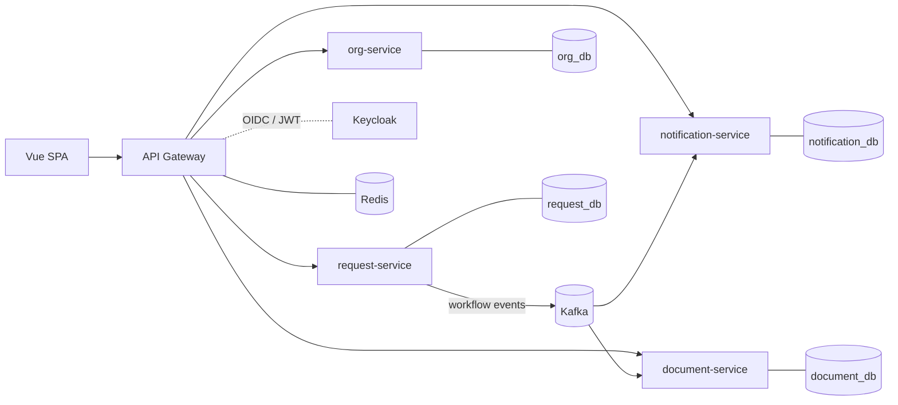

# Request Portal

Request submission and multi-step approval platform, built as Java / Spring Boot microservices.

Students and lecturers submit requests from admin-defined templates (dynamic form fields, file uploads).
Each request moves through an ordered chain of department approval steps with deadlines, and the
system notifies people by email and generates Word/Excel documents along the way.
The full feature list is in [docs/features.md](docs/features.md).

> Status: **phase 4 — events**. Templates, submissions and department approvals with a full audit trail;
> workflow events published to Kafka through a transactional outbox; email notifications and deadline
> reminders; per-user rate limiting in the gateway. Deployment, files and the web app come next; see the
> [Roadmap](#roadmap).

## Architecture



| Service | Port | Responsibility |
|---|---|---|
| `gateway` | 8080 | Single entry point; routing and JWT validation (rate limiting later) |
| `org-service` | 8081 | Accounts, roles, departments, academic terms, student profiles |
| `request-service` | 8082 | Templates, submissions, approval workflow, audit log |
| `document-service` | 8083 | Files on S3, `.docx`/`.xlsx` generation, bulk ZIP jobs |
| `notification-service` | 8084 | Email notifications and deadline reminders from workflow events |

Design decisions are recorded as ADRs in [docs/adr](docs/adr):
[why microservices for a small domain](docs/adr/0001-microservices-for-a-small-domain.md),
[database per service](docs/adr/0002-database-per-service.md),
[identity with Keycloak](docs/adr/0003-identity-with-keycloak.md),
[the request workflow](docs/adr/0004-request-workflow.md),
[events and notifications](docs/adr/0005-events-and-notifications.md).
The Kafka event format is documented in [docs/events.md](docs/events.md).

Shared code lives in small libraries under [`libs`](libs): `service-security` (JWT resource server,
roles, current user), `service-web` (RFC 9457 errors, paging) and `test-support` (a stand-in for
Keycloak that signs test tokens).

## Tech stack

- **Backend:** Java 25, Spring Boot 4.1, Spring Cloud Gateway, Spring Data JPA, Flyway
- **Data and messaging:** PostgreSQL 18, Apache Kafka 4 (KRaft), Redis 8
- **Security:** Keycloak 26 (OpenID Connect), every service an OAuth2 resource server validating JWTs, Keycloak Admin API
- **Testing:** JUnit 5, AssertJ, Testcontainers
- **Delivery:** Docker, Docker Compose, GitHub Actions; Kubernetes (Helm) and AWS (Terraform) in phase 5
- **Frontend:** Vue 3 + TypeScript (phase 7)

## Getting started

Prerequisites: JDK 25 and Docker. Maven is provided by the wrapper (`./mvnw`).

```bash
# 1. Start local infrastructure (PostgreSQL, Kafka, Redis, Keycloak, Mailpit)
docker compose -f infra/docker-compose.yml up -d

# 2. Build everything and run the tests (tests start their own PostgreSQL with Testcontainers)
./mvnw verify

# 3. Run the services against the local infrastructure (one terminal each)
./mvnw -pl services/org-service spring-boot:run
./mvnw -pl services/request-service spring-boot:run
./mvnw -pl services/notification-service spring-boot:run
./mvnw -pl services/gateway spring-boot:run

# Or run a service against a throwaway database, without docker compose
./mvnw -pl services/org-service spring-boot:test-run
```

Check it is up: `curl localhost:8080/actuator/health` (gateway); services answer on 8081–8084.

### Test users

Keycloak imports the `request-portal` realm from [`infra/keycloak`](infra/keycloak/realm-request-portal.json)
on first start. All passwords are `password` (local only).

| Username | Name | Role | Department |
|---|---|---|---|
| `student` | Nguyễn Văn An | `STUDENT` | |
| `lecturer` | Trần Thị Bình | `LECTURER` | |
| `staff.academic` | Lê Văn Cường | `STAFF` | `ACAD` |
| `staff.finance` | Phạm Thị Dung | `STAFF` | `FIN` |
| `admin` | Hoàng Minh Em | `ADMIN` | `IT` |

### Try the API

With all four services and the gateway running, `scripts/demo-workflow.sh` walks one request through the
whole workflow as three users: a student submits an official transcript request (and retries it safely),
Academic Affairs and then Finance complete their steps, the student reads the history, and the script
lists the emails that arrived in Mailpit (http://localhost:8025). It needs `jq`. The development data includes four sample templates, departments and academic terms.

`scripts/token.sh <username>` prints an access token for a test user, for your own calls:

```bash
# Who am I? (creates the account on first call)
curl -H "Authorization: Bearer $(scripts/token.sh student)" localhost:8080/api/v1/accounts/me

# Admin: accent-insensitive search, and change someone's access
curl -H "Authorization: Bearer $(scripts/token.sh admin)" "localhost:8080/api/v1/accounts?q=nguyen"
curl -X PUT -H "Authorization: Bearer $(scripts/token.sh admin)" -H "Content-Type: application/json" \
     -d '{"roles": ["LECTURER", "STAFF"], "departmentId": 1}' \
     localhost:8080/api/v1/accounts/<account-id>/access
```

| Endpoint | Who | Purpose |
|---|---|---|
| `GET /api/v1/accounts/me` | signed in | Current account, synced from the token |
| `GET /api/v1/accounts?q=&role=&departmentId=&page=&size=&sort=` | `ADMIN` | Search accounts |
| `GET /api/v1/accounts/{id}` | `ADMIN` | One account |
| `PUT /api/v1/accounts/{id}/access` | `ADMIN` | Set roles and department (written to Keycloak) |
| `GET /api/v1/departments`, `GET /api/v1/departments/{id}` | signed in | Departments |
| `POST /api/v1/departments`, `PUT /api/v1/departments/{id}` | `ADMIN` | Create, rename (optimistic locking) |
| `GET /api/v1/terms?schoolYear=`, `GET /api/v1/terms/school-years` | signed in | Academic terms and school years |
| `POST /api/v1/terms` | `ADMIN` | Add a term (overlapping dates are rejected) |
| `GET /api/v1/templates/available` | student, lecturer | Templates I can submit |
| `GET /api/v1/templates/{id}` | signed in | One template with its fields and steps |
| `GET /api/v1/templates?status=`, `POST /api/v1/templates`, `PUT /api/v1/templates/{id}` | `ADMIN` | Manage templates |
| `POST /api/v1/requests` (header `Idempotency-Key`) | student, lecturer | Submit a request |
| `GET /api/v1/requests/mine?status=` | signed in | My requests |
| `GET /api/v1/requests/{id}` | requester, involved staff, admin | Values, steps and history |
| `POST /api/v1/requests/{id}/cancel` | requester | Cancel before any step is completed |
| `GET /api/v1/requests?q=&templateId=&status=&awaitingMe=&resultReceived=&submittedFrom=&submittedTo=&departmentCode=` | `STAFF`, `ADMIN` | Department queue / all requests |
| `POST /api/v1/requests/{id}/steps/{position}/complete`, `.../reject` | `STAFF` of the step's department | Process the current step |
| `POST /api/v1/requests/bulk/complete`, `/bulk/reject` | `STAFF` | Process many requests, all or nothing |
| `PUT /api/v1/requests/{id}/result-received`, `PUT /api/v1/requests/result-received` | `STAFF` of the last department | Record that the result was collected |
| `GET /api/v1/notifications?requestId=&status=&kind=` | `ADMIN` | Emails and their delivery status |
| `POST /api/v1/notifications/{id}/retry` | `ADMIN` | Resend a failed or skipped email |

The gateway rate-limits each user per service (10 requests per second, bursts of 30) and answers `429` beyond that.

Errors use [RFC 9457](https://www.rfc-editor.org/rfc/rfc9457) problem details, with per-field messages for validation errors.

### Local infrastructure

| Component | Address | Credentials (local only) |
|---|---|---|
| PostgreSQL | `localhost:5433` | one database and role per service, see [`01-databases.sql`](infra/postgres/init/01-databases.sql) |
| Kafka | `localhost:9094` | none |
| Redis | `localhost:6380` | none |
| Keycloak | http://localhost:8180 (realm `request-portal`) | admin console: `admin` / `admin` |
| Mailpit (catches all outgoing email) | http://localhost:8025 | none |

Host ports are moved off the defaults so the stack can run next to other local projects.

## Roadmap

- [x] **Phase 1 — Foundation:** Maven multi-module build, service skeletons, local infrastructure, CI
- [x] **Phase 2 — Identity:** Keycloak realm, JWT validation at gateway and services, `org-service` APIs
- [x] **Phase 3 — Core workflow:** templates, dynamic fields, academic terms, submissions, approval steps, audit log
- [x] **Phase 4 — Events:** Kafka with a transactional outbox, `notification-service` emails, deadline
  reminders, Redis rate limiting in the gateway
- [ ] **Phase 5 — Deployment and operations:** container images, Helm charts on a local Kubernetes cluster,
  Terraform for AWS, tracing and dashboards, load tests, an Ansible playbook for k3s and Rancher
- [ ] **Phase 6 — Documents:** S3 uploads, `.docx` form filling, Excel exports, bulk ZIP jobs
- [ ] **Phase 7 — Frontend:** a lean Vue 3 + TypeScript app over the API

Phases are ordered by what a backend role values most: messaging and operations come before
documents and the user interface.
