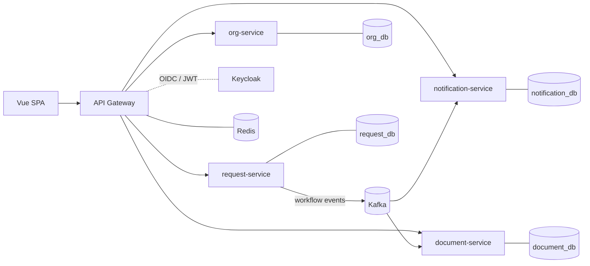

# Request Portal

Request submission and multi-step approval platform, built as Java / Spring Boot microservices.

Students and lecturers submit requests from admin-defined templates (dynamic form fields, file uploads).
Each request moves through an ordered chain of department approval steps with deadlines, and the
system notifies people by email and generates Word/Excel documents along the way.
The full feature list is in [docs/features.md](docs/features.md).

> Status: **phase 1 — foundation**. Services boot, connect to their own databases and are routed
> through the gateway; business features arrive in the phases listed under [Roadmap](#roadmap).

## Architecture



| Service | Port | Responsibility |
|---|---|---|
| `gateway` | 8080 | Single entry point; routing, JWT validation and rate limiting |
| `org-service` | 8081 | Accounts, roles, departments, academic terms, student profiles |
| `request-service` | 8082 | Templates, submissions, approval workflow, audit log |
| `document-service` | 8083 | Files on S3, `.docx`/`.xlsx` generation, bulk ZIP jobs |
| `notification-service` | 8084 | Email notifications and deadline reminders from workflow events |

Design decisions are recorded as ADRs in [docs/adr](docs/adr):
[why microservices for a small domain](docs/adr/0001-microservices-for-a-small-domain.md),
[database per service](docs/adr/0002-database-per-service.md).

## Tech stack

- **Backend:** Java 25, Spring Boot 4.1, Spring Cloud Gateway, Spring Data JPA, Flyway
- **Data and messaging:** PostgreSQL 18, Apache Kafka 4 (KRaft), Redis 8
- **Security:** Keycloak (OpenID Connect), OAuth2 resource servers with JWT
- **Testing:** JUnit 5, AssertJ, Testcontainers
- **Delivery:** Docker, Docker Compose, GitHub Actions; Kubernetes (Helm) and AWS (Terraform) in phase 7
- **Frontend:** Vue 3 + TypeScript (phase 6)

## Getting started

Prerequisites: JDK 25 and Docker. Maven is provided by the wrapper (`./mvnw`).

```bash
# 1. Start local infrastructure (PostgreSQL, Kafka, Redis, Keycloak, Mailpit)
docker compose -f infra/docker-compose.yml up -d

# 2. Build everything and run the tests (tests start their own PostgreSQL with Testcontainers)
./mvnw verify

# 3. Run a service against the local infrastructure
./mvnw -pl services/org-service spring-boot:run
./mvnw -pl services/gateway spring-boot:run

# Or run a service against a throwaway database, without docker compose
./mvnw -pl services/org-service spring-boot:test-run
```

Check it is up: `curl localhost:8080/actuator/health` (gateway), `curl localhost:8081/actuator/health` (org-service).

### Local infrastructure

| Component | Address | Credentials (local only) |
|---|---|---|
| PostgreSQL | `localhost:5433` | one database and role per service, see [`01-databases.sql`](infra/postgres/init/01-databases.sql) |
| Kafka | `localhost:9094` | none |
| Redis | `localhost:6380` | none |
| Keycloak | http://localhost:8180 | `admin` / `admin` |
| Mailpit (email inbox) | http://localhost:8025 | none |

Host ports are moved off the defaults so the stack can run next to other local projects.

## Roadmap

- [x] **Phase 1 — Foundation:** Maven multi-module build, service skeletons, local infrastructure, CI
- [ ] **Phase 2 — Identity:** Keycloak realm, JWT validation at gateway and services, `org-service` APIs
- [ ] **Phase 3 — Core workflow:** templates, dynamic fields, submissions, approval steps, audit log
- [ ] **Phase 4 — Events:** Kafka with transactional outbox, `notification-service`, deadline reminders
- [ ] **Phase 5 — Documents:** S3 uploads, `.docx` form filling, Excel exports, bulk ZIP jobs
- [ ] **Phase 6 — Frontend:** Vue 3 + TypeScript SPA
- [ ] **Phase 7 — Production readiness:** load tests, tracing and dashboards, Helm, Terraform
